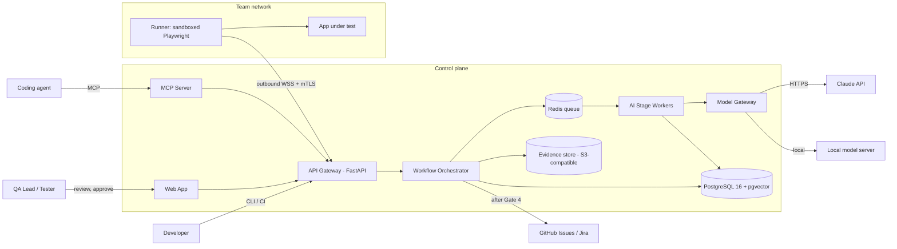

# 02 · Architecture

## 1. Design principles

1. **Workflow with AI steps, not one free-roaming agent.** Fixed input/output per stage, human gates where it matters. Only Explorer and Healer run open tool loops, with strict tool lists and step budgets.
2. **Control plane ≠ runner.** The control plane holds the brain and data. The runner holds the browsers and sits next to the app under test, connecting **outbound only**.
3. **Everything cites a source.** No node, expected result, verdict or bug without a source or evidence link.
4. **Plug-in boundaries** for execution engine, model provider, tracker and storage.
5. **Local-first.** Full system runs on one laptop with Docker Compose. Team server and hosted mode reuse the same code.

## 2. System context



## 3. Components

| Component | Responsibility | Technology | Code |
|---|---|---|---|
| Web App | Setup wizard, graph review, plan, case review, run dashboard, bug review, reports, settings | React 18 + TypeScript + Vite, Tailwind, shadcn/ui (Radix), TanStack Query/Table, React Flow, Recharts | `apps/web` |
| API Gateway | REST, auth, RBAC, rate limits, SSE | Python 3.12, FastAPI, Pydantic v2 | `apps/api` |
| Orchestrator | Stage state machine, gates, retries, budgets | Python, state stored in Postgres, outbox relay to Redis Streams (ADR-013) | `apps/orchestrator` |
| Stage Workers | Analyst, Explorer, Planner, Designer, Compiler, Judge, Reporter, Healer | Python workers on Redis Streams consumer groups (ADR-013) | `apps/workers` |
| Model Gateway | Provider adapters, structured output, citations, caching, replay cache, cost, redaction | `anthropic` SDK, local adapter | `packages/model_gateway` |
| Code Analyzer | Routes, forms, validation, endpoints | tree-sitter (JS/TS, Python, PHP, Java), OpenAPI parser | `packages/analyzers/code` |
| Document Analyzer | Citable chunks with page + line offsets | PyMuPDF, python-docx, markdown-it | `packages/citations` |
| Runner | Execute Playwright, explore UI, capture evidence | Python, Playwright, Docker, axe-core | `apps/runner` |
| Evidence Store | Screenshots, traces, video, HAR, logs | Any S3-compatible store (company S3 in production; SeaweedFS locally, ADR-010), boto3 client, content-addressed by SHA-256 | — |
| Database | All domain data + audit ledger | PostgreSQL 16 + pgvector, Alembic | `apps/api/db` |
| Exporters | Excel, HTML evidence pack, tracker tickets | openpyxl, Jinja2, GitHub/Jira REST | `packages/exporters` |
| Policy | Safe-action rules, domain allow-list, permissions | Pure Python, 100% branch-tested | `packages/policy` |
| Learning Service | Feedback store, lessons (pgvector), nightly trainer, eval gate, model registry, rollback; trains only on human-confirmed labels, inside the company deployment | Python, scikit-learn / LightGBM, Celery beat | `packages/learning`, `apps/workers/trainer` |
| MCP + CLI | Coding agent & terminal access | MCP Python SDK, Typer | `apps/mcp`, `apps/cli` |

**Why Python for the core:** one language for AI, runner, Playwright and data tools; the team's background is data science. TypeScript only for the web UI.

> **Decision note.** The October proposal listed Next.js and LangGraph. The November plan replaces them with React + Vite (pure SPA, no SSR needed behind login) and an explicit Postgres-backed state machine (easier to test, resume and audit). Recorded as ADR-002 and ADR-006.

## 4. Layered view

| Layer | Contains | May call |
|---|---|---|
| Presentation | Web, CLI, MCP | API only |
| API | Routers, auth, validation | Services |
| Service / domain | projects, sources, graph, plans, cases, runs, verdicts, bugs, audit, billing | Repos, orchestrator, policy |
| Orchestration | State machine, gate checks, job dispatch | Queue, repos |
| Workers | AI stages | Model gateway, analyzers, repos |
| Infrastructure | Postgres, Redis, S3-compatible storage, model providers, trackers | — |

Rule: a layer never imports from a layer above it. `packages/policy` and `packages/citations` import nothing from `apps/`.

## 5. Deployment modes

| Mode | Who | How | Release |
|---|---|---|---|
| Laptop | Student / single dev | `docker compose up`, runner on same machine | MVP |
| Team server | Small team | Control plane on one server, runners on dev machines / CI | v1 (Helm) |
| Hosted + local runner | No-server teams | We host control plane; runner and code stay in their network | v2 |

## 5a. Self-learning and data boundary

- The system **learns from its own testing**: run memory, lessons from human decisions, and small models (flake classifier, risk model, confidence calibration, locator stability) retrained nightly and promoted only if evals improve. Details are in [21-self-learning-and-data-privacy.md](21-self-learning-and-data-privacy.md).
- **All data and everything learned stays in the company**: Smart QA runs on the company's servers, uses the company's own PostgreSQL and object storage (bring your own database), keeps secrets in the company KMS, sends no telemetry by default, and can run fully air-gapped with a local model.

## 6. Repository structure

```
smart-autonomous-qa/
  apps/
    web/            React front end
    api/            FastAPI gateway (+ db/ models, alembic/)
    orchestrator/   state machine, scheduler
    workers/        analyst, explorer, planner, designer, compiler, judge, reporter, healer
    runner/         Playwright runner, sandbox, evidence capture
    mcp/            MCP server
    cli/            saq command line
  packages/
    model_gateway/  provider interface, adapters, cache, cost, redaction
    graph/          graph schema, merge, diff
    citations/      chunking, offsets, quote verification
    analyzers/      code (tree-sitter), docs
    exporters/      excel, html evidence pack, trackers
    policy/         safe-action rules, permissions
  evals/            golden_projects/, datasets/, run_evals.py
  deploy/           docker-compose.yml, runner.Dockerfile, nginx/
  docs/             this folder + adr/ + security/
```

## 7. Architecture decision records (start list)

| ADR | Decision |
|---|---|
| 001 | Python core, TypeScript only in web |
| 002 | Workflow with gates (explicit state machine), not a free agent / LangGraph |
| 003 | All model calls via Model Gateway interface |
| 004 | Runner is outbound-only over mTLS |
| 005 | Citation format: `source_id, start_offset, end_offset, quote` |
| 006 | React + Vite SPA instead of Next.js |
| 007 | Evidence content-addressed by SHA-256 |
| 008 | Audit ledger hash-chained in Postgres |
| 010 | SeaweedFS as the local S3-compatible evidence store (MinIO image no longer published) |
| 011 | Project isolation: forced RLS, composite foreign keys, separate migrator/app roles |
| 012 | System role with narrow RLS policies for cross-project background work |
| 013 | Redis Streams consumer groups for job dispatch instead of Celery |

Template: `docs/adr/NNN-title.md` with Context, Decision, Consequences, Status.
