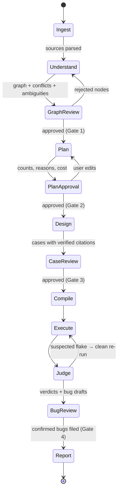
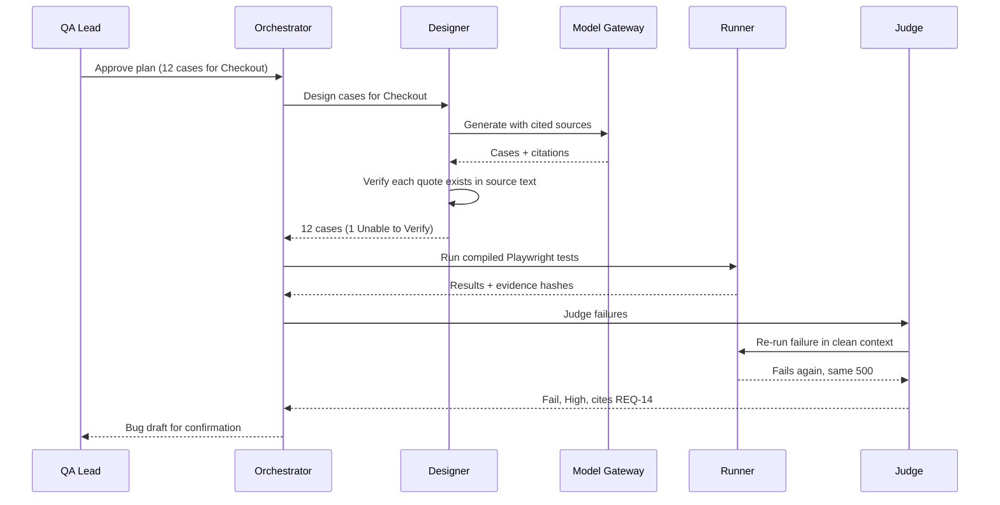

# 03 · System Workflow

## 1. The pipeline in one picture

```
 Connect & Ingest ─▶ Understand ─▶ [GATE 1 Graph review] ─▶ Plan ─▶ [GATE 2 Plan approval]
        ─▶ Design ─▶ [GATE 3 Case review*] ─▶ Compile ─▶ Execute ⇄ Judge (clean re-run)
        ─▶ [GATE 4 Bug confirmation] ─▶ Report & Hand-off ─▶ Learn (regression memory)
```
\* Gate 3 can be skipped for low-risk segments if the QA Lead enables it. Gates 1, 2, 4 are always on and are **enforced in the API**, not just the UI.

## 2. State machine



Stored in table `pipeline_state (project_id, run_id, stage, status, entered_at, payload_ref)`. Every transition writes an `audit_event` and an SSE event.

## 3. Stage table

| # | Stage | Actor | Input | Output | Done when | Sector doc |
|---|---|---|---|---|---|---|
| 1 | Ingest | User + system | Repo / ZIP / URL, docs, env, test identities | `source`, `chunk` rows with offsets | All sources parsed or flagged | [01-ingest](workflows/01-connect-and-ingest.md) |
| 2 | Understand | Analyst + Explorer | Chunks, code facts, crawl | Graph version, conflicts, questions, brief | Graph saved | [02-graph](workflows/02-product-understanding-graph.md) |
| G1 | Graph review | QA Lead | Graph | Approved nodes | Gate 1 signed | same |
| 3 | Plan | Planner | Approved graph, risk inputs | Segments, counts, techniques, reasons, cost | Plan saved | [03-planner](workflows/03-coverage-planner.md) |
| G2 | Plan approval | QA Lead | Plan | Approved plan | Gate 2 signed | same |
| 4 | Design | Designer | Plan + graph | Cases with cited expected results | Every case cited or marked UV | [04-designer](workflows/04-test-designer.md) |
| G3 | Case review | QA Lead / Tester | Cases | Approved cases | Gate 3 signed or skipped | same |
| 5 | Compile | Compiler | Cases | Playwright Python files | Lint + import allow-list pass | [05-executor](workflows/05-executor-and-runner.md) |
| 6 | Execute | Runner | Compiled tests, env | Results + evidence hashes | All cases finished | same |
| 7 | Judge | Judge | Results, evidence, cited rule | Verdict, reason, confidence | Each result has verdict | [06-judge](workflows/06-judge.md) |
| G4 | Bug review | QA Lead | Bug drafts | Confirmed bugs | Gate 4 signed | [07-reporter](workflows/07-reporter-and-handoff.md) |
| 8 | Report | Reporter | Confirmed verdicts | Tracker tickets, Excel, evidence pack | Exports ready | same |
| 9 | Learn | System | Run history, decisions | Regression memory, project rules | Stored | [08-learn](workflows/08-learn-and-maintain.md) |

## 4. One journey, end to end



## 5. Verdict rules (Judge)

| Verdict | Condition | Next action |
|---|---|---|
| Pass | All assertions met, citation verified | none |
| Fail | Fails twice the same way, citation verified | Bug draft → Gate 4 |
| Flaky | Fails once, passes on clean re-run, noise in evidence | Regression memory, no bug |
| Test Error | Our locator/script at fault | Heal proposal (diff) for approval |
| Blocked | CAPTCHA, MFA, login wall, policy block, env down | Report with reason |
| Unable to Verify | No verified source or weak evidence | Human queue |

## 6. Replay runs

Second and later runs use the **deterministic replay cache**: compiled code runs with zero model calls. AI is used only when a step breaks (Judge, Healer). Cost of a stable replay ≈ $0.

## 7. Entry points

| Entry | Who | Starts at |
|---|---|---|
| Web App | QA Lead / Tester | Any stage, respecting gates |
| CLI `saq run` | Developer / CI | Execute with an approved plan |
| MCP `run_journeys` | Coding agent | Execute (read-only unless project allows runs) |
| Webhook (v1) | CI | Change-impact run on PR |
