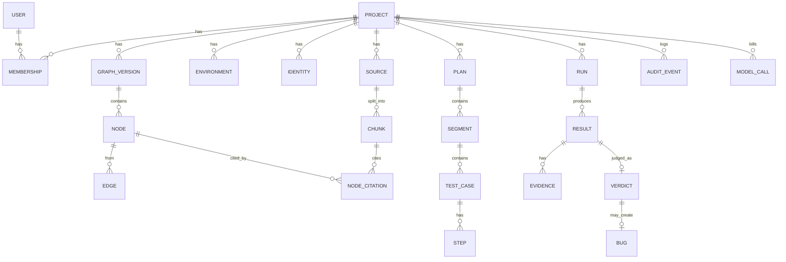

# 07 · Database

PostgreSQL 16 + pgvector · migrations with Alembic · evidence blobs in S3-compatible storage (SeaweedFS locally), only metadata in Postgres.

## 1. ER diagram



## 2. Tables (key columns)

Every table has `id`, `project_id` (except `user`), `created_at`, `updated_at`.

| Table | Key columns | Notes |
|---|---|---|
| `user` | email (unique, citext), password_hash (argon2id), totp_secret_enc, status | |
| `membership` | user_id, project_id, role (enum) | unique (user, project) |
| `project` | name, owner_id, model_policy jsonb, settings jsonb, retention_days | |
| `environment` | name, kind (local/staging/public/production), base_url, allowed_hosts[], safe_actions jsonb, runner_id | production blocked by default |
| `identity` | env_id, role_name, secret_ref | value lives in vault, never in this row |
| `source` | kind (pdf/docx/md/openapi/repo/har), uri, sha256, status | |
| `chunk` | source_id, text, start_offset, end_offset, page, line, embedding vector(1024) | HNSW index on embedding |
| `graph_version` | number, status (draft/approved/superseded), approved_by, approved_at | |
| `node` | graph_version_id, type (Role, Journey, Step, Screen, Field, Rule, Endpoint, Requirement, Conflict, Question), label, attrs jsonb, review_status | |
| `edge` | from_node, to_node, kind | |
| `node_citation` | node_id, chunk_id, start_offset, end_offset, quote, status | |
| `plan` | graph_version_id, status, cost_estimate jsonb, approved_by | |
| `segment` | plan_id, journey_node_id, techniques jsonb, suggested_count, approved_count, risk_score, priority | |
| `test_case` | segment_id, code (TC-CHK-007), role, technique, priority, preconditions jsonb, data jsonb, expected_text, citation jsonb, requirement_id, review_status, compiled_path | |
| `step` | test_case_id, n, action, node_id | |
| `run` | env_id, plan_id, status, started_at, finished_at, last_completed_case_id, totals jsonb | resume point (NFR-4) |
| `result` | run_id, test_case_id, attempt, status, duration_ms, browser | |
| `evidence` | result_id, step_n, kind (screenshot/trace/video/har/console/request), sha256, object_key, size | |
| `verdict` | result_id, verdict (enum), confidence, reason, rule | |
| `bug` | verdict_id, title, severity, body_md, status (draft/confirmed/dismissed/filed), tracker, tracker_ref, dedup_of | |
| `regression_memory` | journey_node_id, last_pass_at, flake_rate, bugs_found | |
| `project_rule` | kind, condition jsonb, action jsonb, source (human decision id) | v1 learning |
| `audit_event` | seq, actor, action, entity, payload jsonb, prev_hash, hash | append-only |
| `model_call` | stage, model, prompt_version, input_tokens, output_tokens, cache_read_tokens, cost_usd, latency_ms, run_id | |
| `replay_cache` | key (sha256 of model+prompt_version+inputs), output jsonb, approved | |
| `pipeline_state` | run_id?, stage, status, payload_ref | |
| `feedback` | entity, entity_id, decision (confirm/reject/edit/heal_approve), before jsonb, after jsonb, actor | Human-confirmed labels: the only training data |
| `lesson` | kind, text, applies_to_node_id, source_feedback_id, embedding vector(1024), active | L2 in-context learning |
| `trained_model` | component (flake/risk/calibration/locator/dedup), version, data_snapshot_hash, metrics jsonb, status (candidate/active/retired), artifact_key | L3 model registry; artifact in company object storage |
| `outbox` | topic, payload, published_at | reliable events |

## 3. How data moves (lifecycle)

1. **Ingest** writes `source` → parser writes `chunk` (+ embedding).
2. **Understand** writes a new `graph_version` (draft) + `node`, `edge`, `node_citation`.
3. **Gate 1** flips `graph_version.status = approved`; previous approved → `superseded`.
4. **Plan** writes `plan` + `segment`; **Gate 2** sets `approved_count`, `plan.status`.
5. **Design** writes `test_case` + `step`; quote check sets `citation.status`.
6. **Run** writes `run`, then one `result` per attempt, `evidence` per step; updates `run.last_completed_case_id` after each case.
7. **Judge** writes `verdict`; Reporter writes `bug` drafts.
8. **Gate 4** sets `bug.status = confirmed`, tracker adapter sets `filed` + `tracker_ref`.
9. Every gate and filing appends `audit_event`.

## 4. Isolation & security

- Team mode: **row-level security** on every table using `project_id = current_setting('app.project_id')`.
- App connects as `saq_app` (no DDL). Migrations run as `saq_migrator`.
- `audit_event`: `REVOKE UPDATE, DELETE` from `saq_app`; trigger computes `hash = sha256(prev_hash || canonical_json(row))`.
- Secrets (`totp_secret_enc`, tracker tokens) encrypted with AES-256-GCM, key from env / KMS.

## 5. Indexes

| Index | Why |
|---|---|
| `chunk USING hnsw (embedding vector_cosine_ops)` | Retrieval for Analyst/Designer |
| `chunk (source_id, start_offset)` | Quote verification lookups |
| `node (graph_version_id, type)` | Graph screen |
| `test_case (segment_id, review_status)` | Case review queue |
| `result (run_id, test_case_id, attempt)` unique | Idempotent result writes |
| `evidence (sha256)` | Dedup |
| `audit_event (project_id, seq)` unique | Chain order |
| `model_call (project_id, created_at)` | Cost reports |

## 6. Migrations

- `alembic revision --autogenerate -m "add regression_memory"` → review the file by hand.
- Expand → migrate → contract: add column nullable, backfill, then make NOT NULL in a later release. Never rename in one step.
- Each migration has a `downgrade()` and is tested in CI against a snapshot of golden-project data.

## 7. Backup & retention

| Item | Policy |
|---|---|
| Postgres | Nightly `pg_dump` (laptop), WAL archiving + PITR (team mode) |
| Evidence | Retention per project (default 90 days); lifecycle rule deletes objects; audit keeps hashes |
| Restore test | Monthly restore into a scratch DB + `audit verify` |
| Project delete | Deletes rows (cascade) and evidence objects; audit event kept with hashes only |

## 8. Useful queries

```sql
-- requirement coverage for latest run
SELECT n.label AS requirement, count(tc.id) AS cases,
       count(*) FILTER (WHERE v.verdict='pass') AS passed
FROM node n
LEFT JOIN test_case tc ON tc.requirement_id = n.attrs->>'req_id'
LEFT JOIN result r ON r.test_case_id = tc.id AND r.run_id = :run
LEFT JOIN verdict v ON v.result_id = r.id
WHERE n.type='Requirement' AND n.graph_version_id = :gv
GROUP BY n.label;

-- where did the money go?
SELECT stage, sum(cost_usd) FROM model_call WHERE run_id=:run GROUP BY stage ORDER BY 2 DESC;
```
