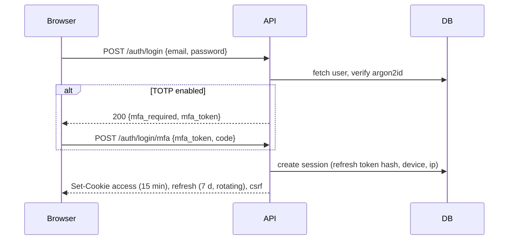

# 10 · Authentication and Security (implementation)

Code: `apps/api/auth/` — `passwords.py` (Argon2id + rule), `tokens.py` (EdDSA JWT, opaque secrets), `service.py` (register, login + lockout, refresh rotation, API tokens), `deps.py` (`current_principal`, `require()`), `permissions.py` (RBAC matrix §4). Endpoints: `apps/api/routers/auth.py`.

**Implemented (M08b):** email + password login, lockout (5 failures → 30 s, doubling, max 1 h, per account), 15-min EdDSA access JWT in `saq_access` (path `/api`), rotating 7-day refresh token in `saq_refresh` (path `/api/v1/auth`) with reuse → family revoke, `saq_csrf` double-submit cookie, logout revokes the family immediately (every request checks the session row), personal API tokens `saq_pat_…` (scopes `read` / `write`, expiry ≤ 365 days, only SHA-256 stored), security headers §7. Cookies are `Secure` when `SAQ_ENV=prod`. **Two-factor (T-105a):** RFC 6238 TOTP (`apps/api/auth/totp.py`, standard library, tested with the RFC vectors); secret stored only AES-256-GCM-encrypted with a user-bound context (`apps/api/crypto.py`, key `SAQ_ENCRYPTION_KEY`); login returns `{mfa_required, mfa_token}` (EdDSA, 5 min, purpose-bound) instead of cookies; a code is accepted once (`totp_last_step`); wrong codes count towards the account lockout. **Not yet:** breached-password check (T-105b), OIDC (v1), runner mTLS (M10).

## 1. Identities

| Principal | How it authenticates | Where |
|---|---|---|
| Human user (web) | Email + password (Argon2id) + optional TOTP → session cookie | MVP |
| Human user (SSO) | OIDC (Google, Microsoft, Keycloak) | v1 |
| CLI / CI | Personal or project API token (`saq_pat_…`), hashed in DB, scoped, expiring | MVP |
| MCP client | Project token with `mcp:*` scopes, read-only by default | MVP preview |
| Runner | Registration token once → mTLS client certificate bound to runner ID | MVP |

## 2. Login flow



## 3. Sessions & tokens

| Item | Setting |
|---|---|
| Access token | JWT (EdDSA), 15 min, claims: `sub`, `sid`, `roles` per project version |
| Refresh token | Opaque, 7 days, rotated on every use; reuse → revoke whole session family |
| Cookies | `HttpOnly`, `Secure`, `SameSite=Lax`, path-scoped |
| CSRF | Double-submit token header `X-CSRF-Token` on unsafe methods |
| Logout | Revokes session; access JWT expires ≤ 15 min (denylist by `sid` for immediate) |
| Brute force | 5 failures → exponential backoff per account (lockout) + 20 login attempts/min per IP (rate limit); alert after 20 |
| Password rules | ≥ 12 chars, check against breached-password list (k-anonymity), no composition rules |

## 4. Authorisation (RBAC)

| Permission | Owner | QA Lead | Tester | Developer | Viewer |
|---|---|---|---|---|---|
| Manage members, model policy, budgets | ✔ | | | | |
| Add sources / environments / identities | ✔ | ✔ | | | |
| Gate 1 approve graph | ✔ | ✔ | | | |
| Gate 2 approve plan | ✔ | ✔ | | | |
| Gate 3 approve cases | ✔ | ✔ | ✔ | | |
| Start run | ✔ | ✔ | ✔ | ✔ | |
| Gate 4 confirm & file bug | ✔ | ✔ | | | |
| Approve heal diff | ✔ | ✔ | | | |
| Mark env production-safe | ✔ | | | | |
| Start / retry / cancel pipeline (`pipeline.manage`) | ✔ | ✔ | | | |
| View everything | ✔ | ✔ | ✔ | ✔ | ✔ |

Implementation:
```python
@router.post("/plans/{plan_id}/approve")
def approve_plan(plan_id: str, user: User = Depends(require("plan.approve"))):
    ...
```
`require()` (in `apps/api/auth/deps.py`) reads `{project_id}` from the path, checks membership + role, and returns a `ProjectContext` whose `session()` is an RLS-scoped transaction. Not a member → **404** (project IDs cannot be probed); member without the permission → **403** with `details.permission`. Resource routes (`/plans/{id}`…) resolve their `project_id` first (M08c). **Separation of duties:** the person who generated a plan can approve it only if they are QA Lead/Owner; a Tester cannot self-approve.

## 5. Secrets

| Secret | Storage | Who can read |
|---|---|---|
| Test identity passwords | Vault table encrypted (AES-256-GCM, envelope key) | Runner only, at fill time |
| Model API key | Env var / Docker secret / KMS | Model Gateway only |
| Tracker tokens | Encrypted column | Tracker adapter only |
| JWT signing key | Docker secret / KMS, rotated 90 days (kid header) | API |
| Runner CA key | Offline / KMS | `saq runner` admin command |

Never logged, never in exports, never sent to a model (placeholders `{{secret:name}}`).

## 6. Runner mTLS

1. Owner creates runner: `saq runner create --env staging` → one-time registration token (10 min).
2. Runner calls `/runner/register` with token + CSR → receives cert (30-day validity, auto-renew at day 20).
3. All later traffic: WSS with client cert; API checks cert serial ↔ runner ID ↔ environment binding.
4. Revoke: `saq runner revoke <id>` → CRL updated, active socket closed.

## 7. Security headers (API + web)

```
Content-Security-Policy: default-src 'self'; img-src 'self' blob: data:; frame-src 'self'; connect-src 'self'; object-src 'none'; base-uri 'none'; frame-ancestors 'none'
Strict-Transport-Security: max-age=63072000; includeSubDomains
X-Content-Type-Options: nosniff
Referrer-Policy: strict-origin-when-cross-origin
Permissions-Policy: camera=(), microphone=(), geolocation=()
```

## 8. Checklist before each release

- [ ] All new endpoints use `require(<permission>)`
- [ ] RLS policy exists for new tables
- [ ] No secret in logs (grep CI step on test logs)
- [ ] ZAP baseline: 0 high
- [ ] Red-team suite green
- [ ] ASVS L1 items re-checked for changed areas
