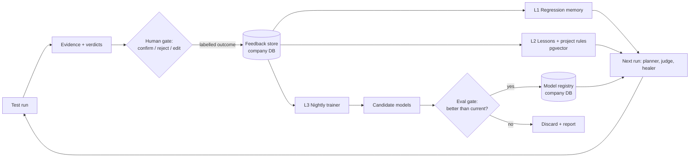
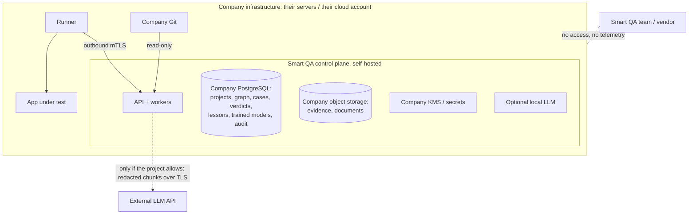

# 21 · Self-Learning and Data Privacy

Two promises, designed together:

1. **Smart QA gets better the longer a company uses it**, by learning from its own test runs and from human decisions.
2. **Everything it learns, and everything it tests, stays inside the company**: in the company's own database, on the company's own servers.

The two fit because learning happens **inside each company's deployment**, on that company's data, and the results never leave it.

---

## Part A · Self-learning

### A1. What "learning" means here (four levels)

| Level | What learns | How | Data used | Release |
|---|---|---|---|---|
| **L1 Memory** | Run history | Stores per-journey pass/fail history, flake rate, bugs found, locator breakages | Runs, verdicts | MVP |
| **L2 Project knowledge** | Prompts (in-context learning) | Human-approved cases, confirmed and rejected bugs, approved heals and edited counts become **lessons**. The most relevant ones are retrieved into the agent's prompt as examples and rules. | Human decisions | MVP-lite, v1 full |
| **L3 Trained components** | Small ML models owned by the project | Retrained nightly on the company's own labelled history (see A3) | Confirmed labels | v1 |
| **L4 Model fine-tuning** (optional) | A local LLM | LoRA fine-tune of the company's local model on approved cases and verdicts, run in-house | Approved outputs | v2 |

The default setup (L1–L3) **never changes the LLM's weights**. It improves the system around the model, which is cheaper, auditable and reversible. L4 is opt-in and runs only on a local model inside the company.

### A2. The learning loop



### A3. What gets trained (L3)

These are small classical models. They train in minutes on a CPU, and the team's data-science background fits them well.

| Component | Learns | Features | Model | Improves |
|---|---|---|---|---|
| **Flake classifier** | Real bug vs flaky run | Timing deltas, HTTP status, network errors, DOM diff, retry outcome, journey flake history | Gradient boosting (LightGBM) | Fewer false bugs |
| **Risk model** | Which journeys break most | Change frequency, code churn from the git diff, rule count, input count, past defects | Logistic regression (explainable weights) | Better test counts and priority |
| **Judge confidence calibration** | When "High" really means high | Judge score and signals vs human-confirmed outcome | Isotonic regression | Honest confidence levels |
| **Locator stability** | Which selector styles survive UI changes in this app | Locator type, attribute stability history | Simple scoring model | Fewer Test Errors, better Compiler choices |
| **Duplicate detector threshold** | When two bugs are the same | Embedding similarity, shared endpoint, shared requirement | Threshold tuned on confirmed duplicates | Less tracker noise |

### A4. Lessons (L2): how agents use past decisions

| Human decision | Lesson stored | Used by |
|---|---|---|
| Rejected bug ("this is expected behaviour") | Rule: "In Checkout, a 422 on expired cards is expected" + the evidence | Judge, Reporter |
| Edited test count (10 → 6) | Project rule: technique weights for this segment type | Planner |
| Approved heal diff | Preferred locator pattern for this screen | Compiler, Healer |
| Edited expected result | Better wording and source linkage example | Designer |
| Answered ambiguity question | New `Rule` node with a citation to the answer | Analyst, Designer |

Lessons are embedded in pgvector and retrieved per task (top-k by similarity and the same graph node). Hard rules are enforced in code, not left to the prompt.

### A5. Safety rules for learning

1. **Only human-confirmed labels train anything.** The system never learns from its own unconfirmed verdicts, which avoids self-reinforcing mistakes.
2. **Eval gate before promotion.** A new model or lesson set must match or beat the current one on the project's eval set and the golden projects. Otherwise it is discarded.
3. **Versioned and reversible.** Every trained model is stored in the registry with its data snapshot hash. `saq learn rollback <component>` restores the previous version.
4. **Never weakens guardrails.** Learning can tune counts, confidence and locators. It can never relax quote verification, the safe-action policy or the approval gates.
5. **Explainable.** The Judge shows "decided by flake model v7 (trained 2026-12-02 on 412 labels)". The risk model shows its weights.
6. **Per-project isolation.** Each project learns only from its own data. There is no learning across companies, ever.
7. **Right to forget.** Deleting a project or a piece of evidence removes its lessons and excludes it from the next retraining.

### A6. Schedule

| Job | When | Command |
|---|---|---|
| Update regression memory | After every run | automatic |
| Write lessons from gate decisions | On each decision | automatic |
| Retrain L3 models | Nightly (if ≥ 30 new labels) | `saq learn train --project prj_1` |
| Eval and promote | After training | `saq learn evaluate --promote-if-better` |
| Learning report | Weekly | `saq learn report` → shows the trend in false-bug rate, flake accuracy and review time |

---

## Part B · Data privacy: data stays in the company

### B1. Where data lives



| Data | Stored in | Leaves the company? |
|---|---|---|
| Source code | Read-only clone on the company server | **Never** stored outside. With the local-model setting, never sent anywhere. |
| Documents (PRD, manual) | Company object storage + DB chunks | Only the needed chunks, redacted, and only in external-model mode |
| Test cases, verdicts, bugs | Company PostgreSQL | No (bugs go only to the company's own GitHub or Jira) |
| Evidence (screenshots, HAR) | Company object storage | No |
| Lessons + trained models | Company PostgreSQL | **No: learning stays in-house** |
| Credentials / test identities | Company KMS / vault | Never, not even to the model |
| Audit ledger | Company PostgreSQL | No |
| Usage telemetry to us | — | **Off by default** (opt-in, aggregate counts only) |

### B2. Bring your own database and storage

Smart QA does not need its own cloud. The company points it at its own infrastructure:

```env
DATABASE_URL=postgresql://saq@db.company.internal:5432/smartqa   # company Postgres (pgvector enabled)
S3_ENDPOINT=https://minio.company.internal                       # or the company's own S3 / Azure Blob / GCS
KMS_PROVIDER=vault                                               # HashiCorp Vault, AWS KMS, Azure Key Vault
SAQ_TELEMETRY=off
SAQ_MODEL_POLICY=local-only                                      # or: external-redacted
```

Smart QA uses a **separate schema or database** for its own data. It never connects to the company's **production application database**. It tests the app only through its UI and API, using test identities.

### B3. Model privacy modes (set per project)

| Mode | What leaves the network | For |
|---|---|---|
| **Local-only (air-gapped)** | Nothing | Banks, government, strict NDAs |
| **External, redacted** (default) | Only the minimum chunks needed for a step, with emails, phones, tokens, IDs and secrets masked | Most teams |
| **External, code allowed** | Plus relevant code snippets (still redacted) | Teams that accept it in writing |

- The **data-sharing page** in the app shows exactly which data type went to which provider, per run.
- External providers must be configured under the company's own API account and agreement. Check that provider's current data-use and retention terms before using it; Smart QA records which provider got what.
- Data sent to an external model is **never** used by us for learning across customers. All learning in Part A happens inside the company's deployment.

### B4. Protection controls (summary; full detail in 09 and 10)

| Control | Where |
|---|---|
| Encryption at rest (DB, object store) + TLS 1.3 in transit | Company infrastructure + app |
| Secrets in company KMS; placeholders to the model | 10-authentication-and-security.md §5 |
| Row-level security per project; role-based access | 07-database.md §4 |
| Redaction before any model call or log | model_gateway/redact.py |
| Tamper-evident audit ledger (who saw, approved or sent what) | 07-database.md |
| Retention limits + one-click project delete (also removes lessons and trained models) | 07-database.md §7 |
| Runner outbound-only; no inbound ports | 09-security.md §5 |
| No vendor remote access; updates pulled as signed images | 09-security.md §9 |

### B5. Privacy checklist for a company deployment

- [ ] Smart QA DB and storage are on company infrastructure (B2)
- [ ] Model policy chosen and approved by the company (B3)
- [ ] Telemetry off (or opt-in approved)
- [ ] KMS connected; no secrets in `.env` in production
- [ ] Retention period set
- [ ] Production app database **not** connected
- [ ] Data-sharing page reviewed by the security officer
- [ ] Backups encrypted and kept inside the company
